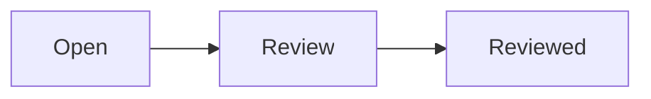
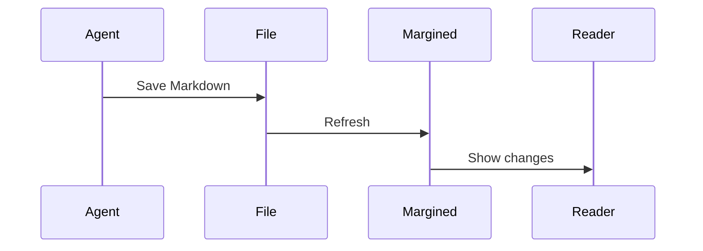

# Alerts, math and diagrams

Open this file in Margined or Finder Quick Look. Print it to check PDF output.

## GitHub alerts

> [!NOTE]
> Keep useful context close to the document.

> [!TIP]
> Use the outline to jump between sections.

> [!IMPORTANT]
> Review saved changes without changing the source.

> [!WARNING]
> Saving checkmarks changes the Markdown file after your first-click consent.

> [!CAUTION]
> Remote images stay off unless you enable them for the current document.

## Mathematics

Inline: $E = mc^2$. GitHub backtick form: $`\sqrt{a_b}`$.

$$
\int_0^1 x^2\,dx = \frac{1}{3}
$$

```math
\sum_{i=1}^{n} i = \frac{n(n+1)}{2}
```

Currency ($5 and $10), escaped \$ and code `$literal$` stay literal.

## Mermaid





## Checklists and tables

- [ ] Read the alerts.
- [ ] Check $x^2$ and both diagrams.
- [ ] Try Print, then Cancel.

| Content | Reader | Quick Look | Print |
| --- | --- | --- | --- |
| Alerts | Styled | Styled | Light paper |
| Math | MathML | MathML | MathML |
| Diagrams | Static artwork | Static artwork | Static artwork |

## Readable fallback

Unsupported expressions and diagrams retain their source:

$\notARealCommand{x}$

```mermaid
this is not a diagram
```
