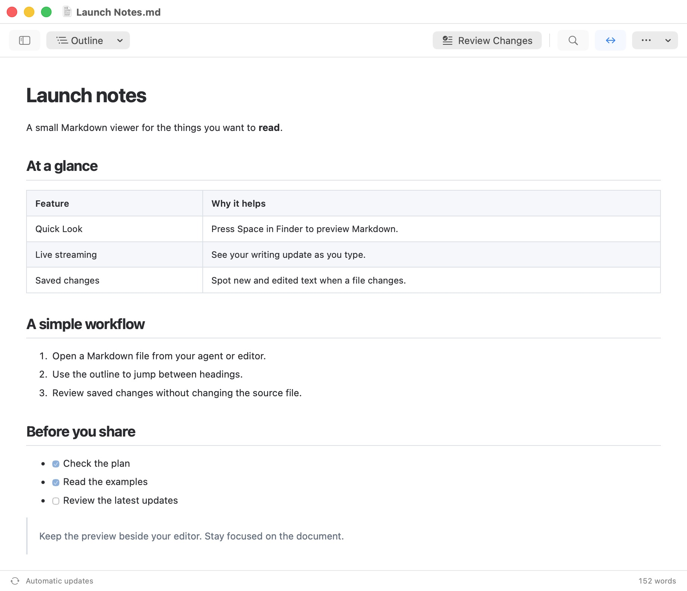
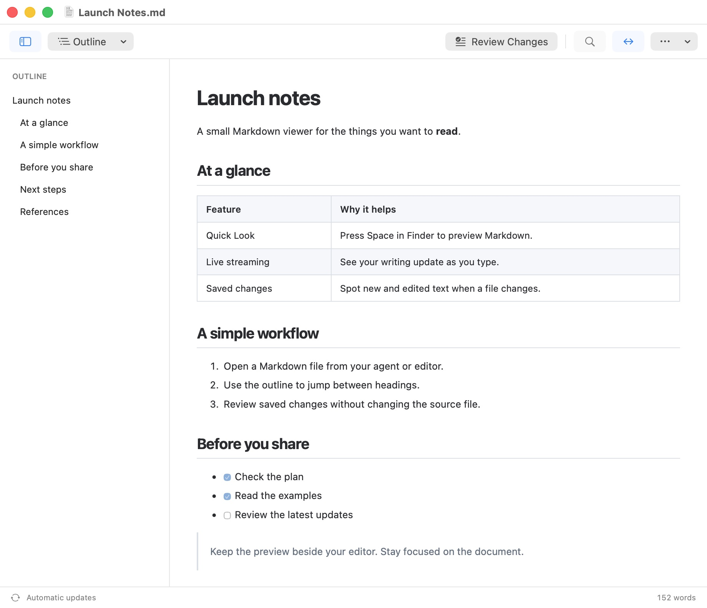
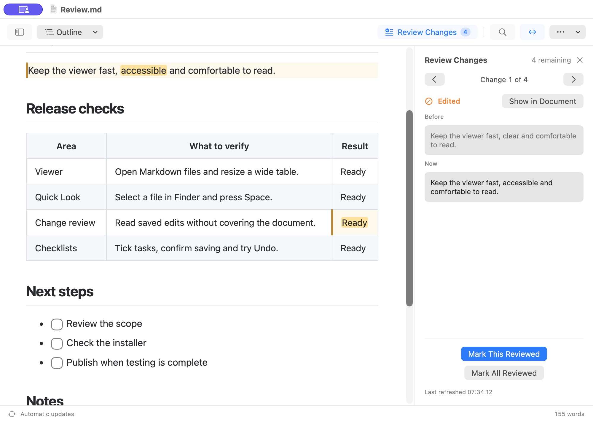
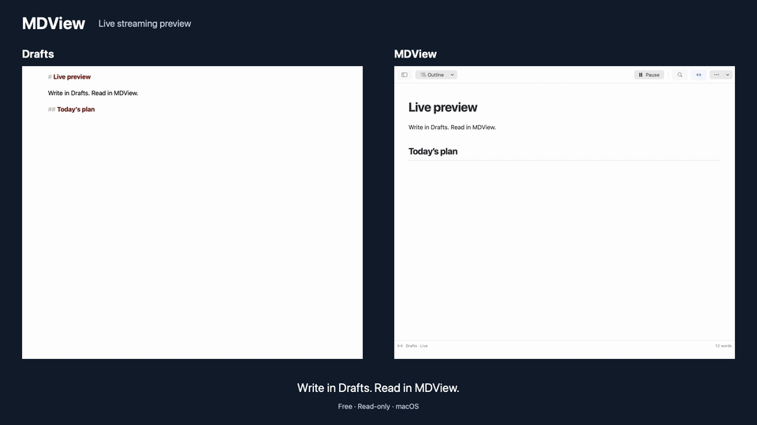

# Margined

A fast Markdown reader for macOS 14 and later, with live updates, change review,
checklists and Read Aloud. Open files written by your agents, or preview a draft
from Drafts.

- Native document windows, Open Recent, and multiple files.
- On-device Read Aloud with installed macOS voices, section navigation and saved positions.
- Automatic refresh, including editors that replace files atomically.
- Tables, task lists, links, footnotes, GitHub alerts, math and Mermaid diagrams.
- Optional checklist saves with first-click consent, automatic per-tick saving, and Undo/Redo.
- Sidebar and top-bar outline navigation, find, zoom, light/dark appearance, and a direct full-width toggle.
- Highlights for saved changes, with previous text, deletions, next/previous navigation, and individual or whole-document acknowledgement.
- A bundled modern Finder Quick Look preview extension.
- A Drafts URL action that sends previews without creating temporary files.
- Live streaming through the public Marked-compatible channel; Drafts is the tested integration.
- English, Spanish, Simplified and Traditional Chinese, Japanese, French and German interfaces.

## Install and use

Download the DMG from the [latest release](https://github.com/HighGainDesign/Margined/releases/latest),
open it, and drag the app onto **Applications**. Eject the installer before
launching the installed copy. Updates use the same process; quit Margined before
replacing it. Margined supports Apple Silicon and Intel Macs running macOS 14 or later.

Open a Markdown file through Finder's **Open With → Margined**, or use **File → Open**.
The setup guide explains the optional Quick Look extension and Drafts action;
both are also available in Settings. You can return to the guide at any time.

Margined is the new name for MDView; existing release downloads and media still
use the previous name. [Version 2.0](ROADMAP.md) is in development around iOS,
portable margin discussions and measured viewing speed. Collaboration is planned,
not yet available.

## See it in action

### A simple Markdown reader

Open documents from your editor or coding agent. Tables, lists, links, and code
blocks render in a native window, read-only until you allow checklist saves. Update status and word count stay
in the footer; reading controls stay in the toolbar.



### Find your place with the outline

Use the sidebar for a persistent document outline, or the **Outline** dropdown
for a quick jump to a heading.



### See what changed

Saved files refresh automatically. Added and edited text is highlighted, and
**Review Changes** shows previous text, deletions, and navigation between changes.
The panel docks beside the document, or below it in narrow windows, keeping the
changed text visible. Drag the divider to resize it; press Escape to close it.
**Mark This Reviewed** clears one highlight and advances to the next change;
**Mark All Reviewed** acknowledges the remaining changes. Neither modifies the file.



### Live streaming

Keep Margined beside Drafts and see headings, lists, and tables update as you write.
**Pause** holds the current preview; **Resume** catches up to the latest text.
There is no export step and no temporary Markdown file to manage.



[Watch or download the 25-second MP4 demo](Assets/Media/live-streaming.mp4).
Recorded from the real Drafts and Margined windows with a disposable sample;
idle time is trimmed, and the pointer is hidden.
See [live streaming setup and compatibility](#live-streaming-and-drafts) below.

## Checklists

Save checklist progress directly to Markdown so agents and other apps can see
which tasks you have completed.

Click a checkbox in a file-backed checklist. The first click asks whether to
**Save Checkmarks** to that file. Cancel leaves it unchanged; confirming saves
that first tick and enables automatic saves for this open document. Each tick
or untick then saves only the task marker (`[ ]` or `[x]`), so agents can read
your progress. **Undo** in the notice or **Edit → Undo Checkbox Change** (⌘Z)
reverses a tick; **Redo Checkbox Change** uses ⇧⌘Z. Select **Stop Saving Checkmarks**
to stop automatic saves and keep your saved progress. Clicking a checkbox again
asks for consent before saving. Closing the document resets the choice. You can also
use **Reading options (…) → Save Checkmarks Automatically**.

Only task markers are changed. Markdown text, encodings, line endings and file
permissions are preserved. Margined checks the current file before writing; if
an agent changed it since the displayed version, the click is refused and the
file is refreshed. External edits clear checkbox Undo history. Tasks that cannot
be mapped safely to their original Markdown remain disabled.

Quick Look, Drafts snapshots and live streams remain read-only. Checklist saves
participate in the existing saved-change comparison, like other file changes.

## Read Aloud

Use the headphones button to open the player, then **Play** (⌥⌘L). Start from the
beginning, current section or selected text; pause, stop (⌥⌘K), skip sections,
choose a voice and adjust speed. **Follow Reading** scrolls with speech without
moving keyboard focus. Settings includes voice preferences, code/link reading
options and **Clear Reading History**.

Speech uses installed macOS voices on-device, with no account or model download.
Voice availability varies by Mac; add voices in macOS Accessibility settings.
Document language controls pronunciation independently of the interface language.
macOS’s per-app language setting chooses the interface language.

While speaking or paused, Margined holds the displayed version and keeps the latest
incoming update separately. **Show Latest** displays it; **Read Latest** switches
and starts reading. Checkmarks cannot save while that version is held. Saved-file
positions use hashes and offsets, never document text; live streams aren’t stored.
Only one document speaks at a time. Sleep or an output-device change pauses speech.

## Print or save as PDF

Choose **File → Print…** (⌘P) to print the rendered document. Use the print
dialog’s **PDF → Save as PDF** option to create a PDF. Printing uses a light
page, paginates tables and wraps code; app controls and temporary highlights
are omitted. Paused documents print the version currently displayed.

## Image sizing

Use GitHub-style HTML to specify an image’s displayed size without shrinking its
source file:

```html

```

Margined preserves valid image width/height attributes and safe HTML formatting,
including disclosure blocks. Scripts, interactive controls and active embeds are
removed. Remote images still require the document’s opt-in. Printing does not add
an image-size cap; the author controls its size.

## Alerts, math and diagrams

GitHub’s `[!NOTE]`, `[!TIP]`, `[!IMPORTANT]`, `[!WARNING]` and `[!CAUTION]`
blockquotes render as labeled callouts. Use `$…$` or ``$`…`$`` for inline
TeX, `$$…$$` or a fenced `math` block for equations, and fenced `mermaid` blocks for
diagrams. Math uses KaTeX; Mermaid diagrams include an expandable source view.

Rendering stays on your Mac and needs no CDN. Invalid or oversized expressions and
diagrams retain readable source. MathML provides mathematical structure to system
accessibility; Read Aloud reads TeX rather than claiming spoken-math interpretation.
Diagram descriptions use authored `accTitle`/`accDescr` when available. Diagrams
use a light drawing surface, including in dark documents and on paper. Try the
[rendering sample](Fixtures/Rendering.md) in the reader, Quick Look or Print.

## Build and run

Install Xcode 26+ and [XcodeGen](https://github.com/yonaskolb/XcodeGen), then run:

```sh
./script/build_and_run.sh
```

The script regenerates the Xcode project, builds both targets, and launches Margined. It supports `--verify`, `--debug`, `--logs`, and `--telemetry`. Build products default to `/tmp/Margined-build-<uid>` so Dropbox metadata does not interfere with code signing. Override with `MARGINED_BUILD_DIR`. It uses an existing Developer ID Application or Apple Development certificate if available; set `MARGINED_SIGNING_IDENTITY` to override.

To run tests after generating the project:

```sh
xcodebuild -project Margined.xcodeproj -scheme Margined \
  -destination 'platform=macOS' -derivedDataPath /tmp/Margined-tests \
  CODE_SIGN_IDENTITY=- test
```

Open a Markdown file with Finder’s **Open With → Margined**, File → Open, or:

```sh
open -a /tmp/Margined-build-$(id -u)/Build/Products/Debug/Margined.app path/to/note.md
```

For everyday use, copy the verified signed app to `/Applications` and launch that copy. The build/run script creates development builds in the temporary folder and does not automatically replace an installed copy.

## Quick Look

The preview extension is embedded in Margined and is installed with the app; no separate installer is needed. Launch the app once. Settings includes **Open Extension Settings…** and a setup guide with an optional **Don’t show again** checkbox. Opening System Settings or importing the Drafts action leaves the guide open; only **Done** or closing the guide saves that choice. Then select a `.md` file in Finder and press Space. You can enable or disable **Margined Quick Look** in **System Settings → General → Login Items & Extensions → By Category → Quick Look** (or search System Settings for Quick Look). macOS may choose another enabled Markdown preview extension; disable competing Markdown extensions if you want Margined’s preview. Disabling Margined’s extension does not affect the app or Drafts action.

Without an Apple signing certificate, the script falls back to ad-hoc signing for app development; Finder Quick Look may require a real Apple signature. Distribution requires signing the app and extension with your own Apple team and notarizing or submitting them. Moving a signed build into Applications provides a stable location for extension registration.

Appearance sharing uses a macOS App Group authorized by the signing team's ID.
An ad-hoc build cannot verify that identity. Automated tests use isolated
preferences; signed app/extension integration must be tested separately. For
your own signed builds, see [Contributing](CONTRIBUTING.md) for team configuration.

## Reading and navigation

Settings offers **System**, **Light**, and **Dark** document appearance. Changes
apply to all document windows and new Finder Quick Look previews. Close and
reopen an existing Quick Look preview to update its appearance.

Documents open at full width by default. The **↔** toolbar button switches the
current window between full and comfortable width; Settings chooses the default
for newly opened documents. Tables fill the reading width and scroll horizontally
when necessary.

Saved files refresh automatically while preserving your reading position. Use
**Reading options → Pause Updates** or the View menu to hold the current version;
Resume catches up to the newest save. A waiting version disables checklist saves.

Changes accumulate against the text you last reviewed during this document
session. Added blocks are green; edited blocks are amber, with changed words
marked. Reviewing advances that comparison baseline without modifying the file.
For very large documents, review uses section positions and labels that limitation.
Drafts URL previews are snapshots; live streams follow the editor separately.

Outline and **Show in Document** move focus to their destination. Review describes
checkbox states, link destinations, and image alternatives. The active reader
announces errors, missing search results, and review progress; rapid updates are combined.

| View command | Shortcut |
| --- | --- |
| Pause/Resume Updates | ⌥⌘P |
| Focus Document | ⌥⌘D |
| Return to Navigation | ⌥⌘U |
| Next/Previous Unchecked Task | ⌥⌘J / ⇧⌥⌘J |
| Next/Previous Unreviewed Change | ⌥⌘] / ⌥⌘[ |

**Reading options → Document Language** overrides on-device detection for the current
window and controls Read Aloud pronunciation. It does not translate document text.
Unknown language stays unspecified. Broader VoiceOver feedback is welcome; these
improvements do not establish full accessibility support.

## Create a signed installer

The release script builds universal Apple Silicon/Intel binaries, verifies app/extension signing and debugger entitlements, notarizes and staples the app, creates a DMG with an Applications symlink, and notarizes and staples the DMG. The Drafts action lives inside the app and can be installed from Settings.

```sh
python3 -m venv /tmp/margined-dmg-env
/tmp/margined-dmg-env/bin/pip install ds_store==1.3.2
MARGINED_DMG_PYTHON=/tmp/margined-dmg-env/bin/python ./script/release.sh
```

Set `MARGINED_SIGNING_IDENTITY`, `MARGINED_TEAM_ID`, and `MARGINED_NOTARY_PROFILE` for your signing setup. The default profile is `Notarize`. `--build-only` produces the signed app; `--skip-notarize` creates a signed local DMG without submitting to Apple. The script never publishes to GitHub. After packaging, it preserves the signed app as a ZIP in the release build folder and removes temporary app/staging copies so macOS cannot rediscover them in Open With or Extensions. Use `--build-only` to keep a build app, or `MARGINED_KEEP_BUILD_APP=1` temporarily for native QA.

The icon uses the public-domain [Markdown Mark](https://github.com/dcurtis/markdown-mark) with a loupe over its enlarged arrow. `App/AppIcon.icon` is the editable four-layer Icon Composer document for macOS and future iOS use. Glass translucency is 35%; the rim has specular lighting, and the arrow stays crisp. Xcode compiles its appearance variants and legacy fallback icon. The flat vector reference and geometry metadata are in `Assets/IconDesign/`.

## Live streaming and Drafts

See [the Drafts action setup](Integrations/Drafts/README.md). URL preview:

```text
margined://preview?text=URL_ENCODED_MARKDOWN&title=URL_ENCODED_TITLE
```

For live typing previews, enable **Marked streaming preview** in **Drafts Settings
→ General**, then choose **File → Live Streaming Preview** in Margined (also available
in Settings and the welcome window). Drafts may require Marked to be installed
to enable its stream, but Marked can stay closed. No Marked upgrade is needed.
Margined independently implements the publicly documented
[Marked streaming protocol](https://markedapp.com/help/Streaming_Preview), created
by Brett Terpstra, using its `mkStreamingPreview` channel. Margined is not affiliated
with or endorsed by Marked. It reads that named channel only while the live
window is open and unpaused; it never reads or writes your ordinary clipboard. **Pause** keeps the
current preview, and **Resume** catches up to the latest streamed text. Other
editors using the same channel are accepted too; their compatibility has not
been manually verified. The footer displays the editor’s optional source
metadata, or “Live stream” when none is supplied.

An optional Drafts URL action can open this window with `margined://stream`.
Opening it again reuses the live window. Live streams do not create files or
change drafts. Unlike saved-file change review, they show the current text
without accumulating highlights across different drafts. The channel does not
identify drafts by UUID, so it cannot pin a preview to a particular draft.
Relative images have no document folder to resolve against; remote images
retain the usual per-window opt-in.

## Rendering and iOS

[Apex](https://github.com/ApexMarkdown/apex) 1.1.34 parses Markdown through its native
C library; its unchanged build sources are vendored with revision hashes.
[SwiftSoup](https://github.com/scinfu/SwiftSoup) 2.13.9 sanitizes and adapts HTML.
Bundled KaTeX 0.19.0 produces static MathML; Mermaid 11.17.2 produces sanitized SVG
images in a private, offline WebKit worker. The displayed document cannot run
scripts. Ordinary documents do not start the diagram worker.

App and Quick Look share parsing, static output and CSS. Rendering code can be
reused by a future iOS reader; native document/window/audio handling stays separate.
See [dependency provenance](Vendor/Apex/PROVENANCE.md) and [contributing](CONTRIBUTING.md)
for reproducible builds. There is no runtime CDN or external rendering service.

## Current boundaries

- Documents are read-only by default. Explicit checkmark consent changes only task markers in a user-selected file; arbitrary text editing is not supported.
- UTF-8 and BOM-marked UTF-16 files are supported, up to 8 MB.
- Safe HTML formatting, GitHub alerts, KaTeX math and Mermaid diagrams are supported. Author scripts, parser plugins, file includes and external rendering services are disabled.
- Rendering is bounded: up to 200 math expressions and 20 diagrams per document, 16 KB per expression and 20 KB per diagram. Diagram work has time/edge limits; source remains readable when a limit is reached. Custom diagram scripts, HTML labels and remote resources are blocked. Full GitHub/MathJax parity is not claimed.
- Images linked to websites are off by default. In the current document’s **Reading options (…) → Load Remote Images**, you can opt in to HTTPS images. Hosts can see your IP address and image requests; Margined sends no document referrer. This choice lasts only until you close the document, and Quick Look never loads remote images. Local images load automatically from relative paths, absolute paths, local `file://` URLs and symlinks wherever macOS permits access. There are no Margined image-folder grants or document-folder boundaries; image formats are handled by WebKit. The directly distributed macOS app uses normal filesystem access, subject to macOS privacy permissions and file permissions. Quick Look previews text and embedded data images.
- Links open in the browser/mail app; relative file links open as another document subject to macOS file permissions.
- Code blocks use monospace styling; syntax coloring, PDF export, and an iOS app are future work.

## Licenses

Margined is released under the [MIT license](LICENSE). Contributions and bug reports
are welcome; see [Contributing](CONTRIBUTING.md) and the [changelog](CHANGELOG.md).
For vulnerability reports, see [Security](SECURITY.md).

Apex, libyaml, SwiftSoup, KaTeX and Mermaid use MIT licenses; cmark-gfm includes BSD-2-Clause and component notices. Dependency license texts are bundled with the reader.
The Markdown Mark is public domain; its notice is also bundled.
